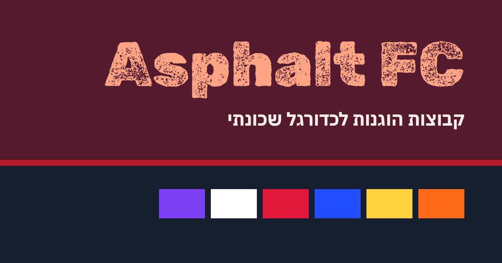
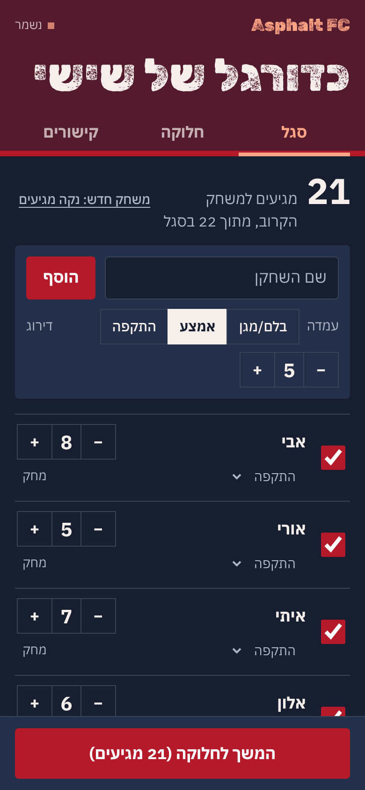
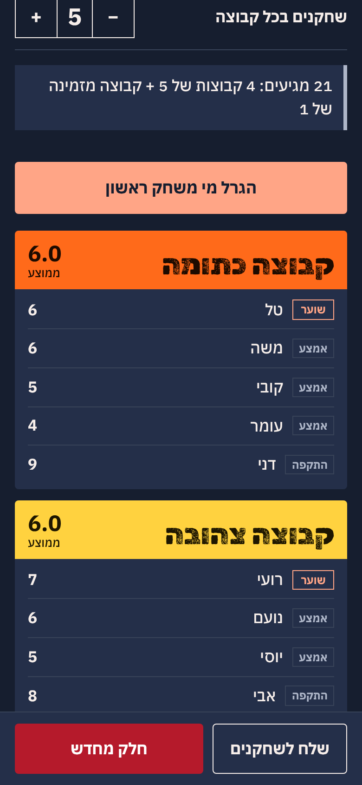
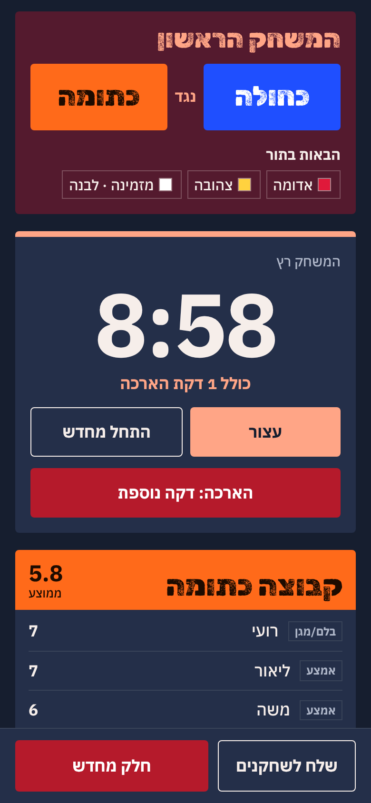
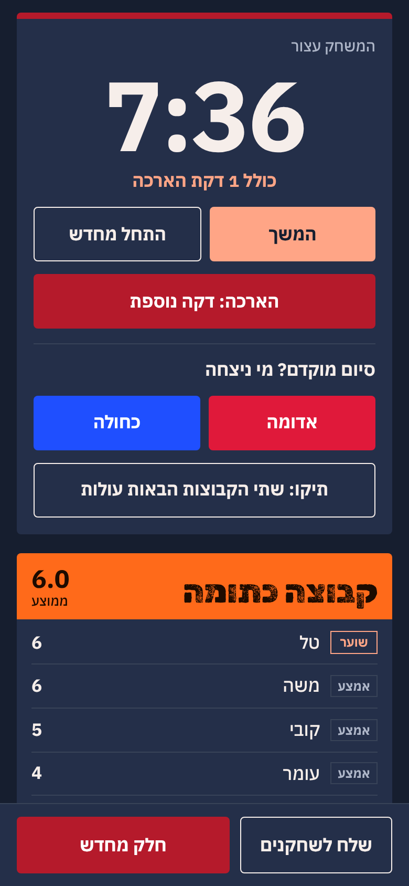
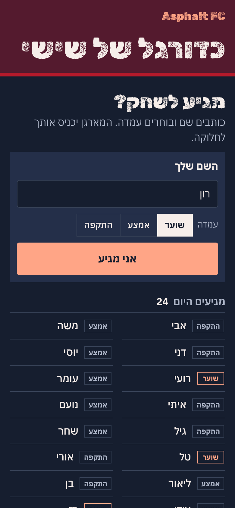
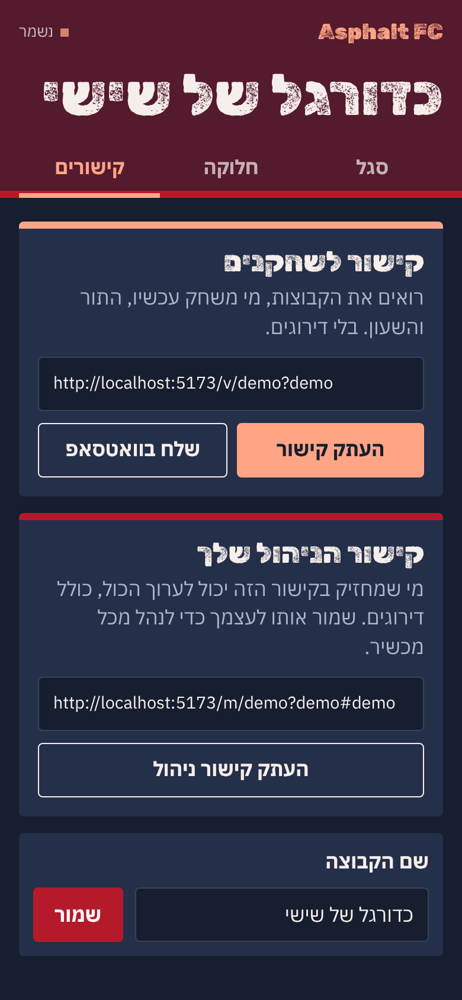

<p align="center">
  
</p>

<h1 align="center">Asphalt FC</h1>

<p align="center">
  <b>Fair teams for neighborhood football.</b><br>
  Rate your regulars once, split whoever showed up into balanced teams, draw who kicks off, and run the match clock. No sign-up.
</p>

<p align="center">
  
</p>

<p align="center">
  <a href="[https://asphaltfc.football.workers.dev](https://asphaltfc.playfootball.workers.dev/)"><b>Open the app ↗</b></a>
</p>

<p align="center">
  
  
  
  
</p>

<div dir="rtl" align="center">

**כדורגל שכונתי בלי ויכוחים:** מכניסים שחקנים ודירוג פעם אחת, מקבלים קבוצות מאוזנות, מגרילים מי פותח ומפעילים שעון. בלי הרשמה ובלי מייל.

</div>

---

## Screenshots

<table>
  <tr>
    <td align="center"><br><sub><b>Squad</b>: name, position, rating 1–10, who's here today</sub></td>
    <td align="center"><br><sub><b>Split</b>: 3–10 teams, any team size, balanced by rating</sub></td>
    <td align="center"><br><sub><b>Match</b>: opening draw, queue and the match clock</sub></td>
  </tr>
  <tr>
    <td align="center"><br><sub><b>Result</b>: winner stays, draws handled by the house rules</sub></td>
    <td align="center"><br><sub><b>Player link</b>: teams, queue and clock, never ratings</sub></td>
    <td align="center"><br><sub><b>Links</b>: share with players, keep the manager link</sub></td>
  </tr>
</table>

## Features

- **No accounts.** Create a group with a name. You get a private manager link and a separate view-only link for players.
- **Squad that remembers.** Add each regular once with a position (goalkeeper, midfield, attack) and a 1–10 rating. Each week just tick who showed up.
- **Fair split.** Pick 3 to 10 teams and players per team. Every full team gets a goalkeeper, positions are mixed, and averages are balanced. Leftover players form the waiting team (קבוצה מזמינה).
- **Opening draw.** One tap draws the two teams that kick off. The rest queue in random order, with the waiting team last.
- **Match clock.** Set the length (8 minutes by default), start, pause for a ball over the fence or a penalty argument, resume or restart. When teams are waiting, add extra time one minute at a time. A whistle sounds when time is up, and the screen stays awake while the clock runs.
- **Rotation.** Pick the winner: the winner stays, the loser goes to the back, the next team comes on. On a draw with one team waiting it goes to penalties; with two or more waiting, both drawn teams step off and the next two come on.
- **Live player view.** Players open their link and see the teams, who is on, the queue and the running clock, synced to server time.
- **Ratings stay private.** The player endpoint strips ratings and the fairness spread on the server, so they never reach a player's phone.
- **Installable.** Add to the home screen and it runs full screen like an app.

## How the split works

`web/src/teams.js` builds teams in three passes:

1. **Goalkeepers first**, one per full team, each to the currently weakest team.
2. **Everyone else, strongest first**, to the team with the lowest average so far, with a penalty for stacking one position in the same team.
3. **Swaps.** Same-position players are swapped between teams while it lowers the variance of team averages.

A little noise on each rating means **Split again** gives a different but equally fair result. With the sample squad the gap between the strongest and weakest full team is usually under half a rating point.

## Tech stack

| Layer | Choice |
| --- | --- |
| Front end | Plain HTML, CSS and JavaScript modules. No framework and no build step. |
| Type | Rubik Dirt for display, IBM Plex Sans Hebrew for text and numbers |
| Back end | Supabase (PostgreSQL). A single `asphalt_groups` table behind `SECURITY DEFINER` functions. Row level security is on and the table is never exposed directly. |
| Auth model | Manager secret (stored hashed with SHA-256) in the manager link; a separate random code for the player link |
| Hosting | Static hosting on Cloudflare (or Netlify) with SPA routes for `/m/*` and `/v/*` |
| App shell | Web app manifest, home-screen icons, Screen Wake Lock, Web Audio whistle |

## Project structure

```
web/
  index.html            app shell
  styles.css            design tokens and components
  src/main.js           routing, manager screens, player view, match clock
  src/teams.js          bibs, fair split, draw and rotation rules
  src/api.js            Supabase RPC client and the local demo adapter
  icons/                app icons and share image
  manifest.webmanifest
  _redirects            SPA routes
  _headers              security and cache headers
supabase/migrations/    database table and functions
docs/screenshots/       images used in this README
wrangler.jsonc          Cloudflare config
netlify.toml            Netlify publish folder
```

## Running locally

Any static server that falls back to `index.html` for `/m/*` and `/v/*` works. With the Netlify CLI:

```bash
npx netlify dev
```

Add `?demo` to any URL to use a local sample group instead of the server, for example `http://localhost:8888/?demo`. Demo data lives only in your browser.

## Database

Apply the migration in `supabase/migrations/` to your Supabase project (SQL editor or `supabase db push`), then set `SB_URL` and `SB_KEY` in `web/src/api.js` to your project URL and publishable key. The functions are:

| Function | Who calls it | What it does |
| --- | --- | --- |
| `asphalt_create(name)` | anyone | creates a group, returns its id, manager secret and view code |
| `asphalt_admin_get(id, secret)` | manager | full state, including ratings |
| `asphalt_admin_save(id, secret, state, name)` | manager | saves the state (up to 200 KB) |
| `asphalt_view(code)` | players | public state without ratings or the fairness spread |

## Deploying

The site is plain static files in `web/`, so no build step is needed.

- **Cloudflare:** connect the repository in Workers & Pages. `wrangler.jsonc` serves `web/` and falls back to `index.html` for app routes, and the deploy command is `npx wrangler deploy`.
- **Netlify:** connect the repository. `netlify.toml` sets the publish folder to `web`.

Routes live in `web/_redirects` and security headers in `web/_headers`; both hosts read them.

## Version history

- **v2 · Asphalt FC.** New name and design, goalkeeper/midfield/attack positions, 3–10 teams of any size, waiting team, opening draw, match clock with extra time, winner-stays rotation with draw rules, live player view.
- **v1 · tiko.** The first version: fixed teams of five, self sign-up and RSVP links, captains, penalties and game history.
